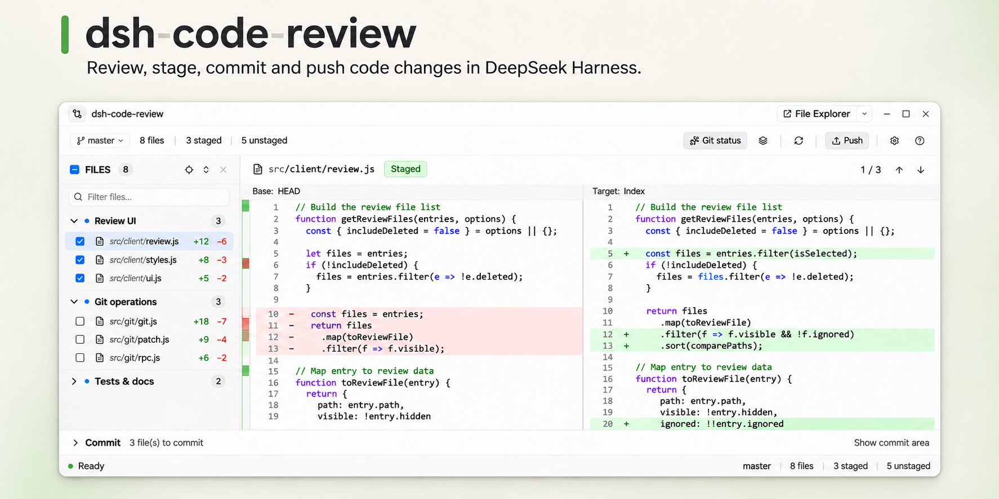
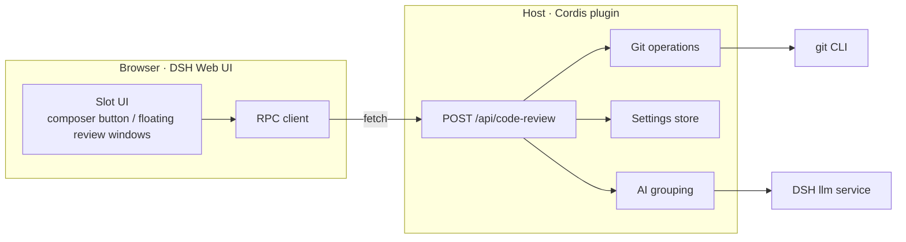

<p align="center">
  
</p>

<h1 align="center">dsh-code-review</h1>

<p align="center">Review, stage, and commit uncommitted changes of the current conversation's Git repository in non-modal floating windows inside the DSH Web UI.</p>

<p align="center">
  <a href="README.md">中文</a> · <b>English</b>
</p>

<p align="center">
  
  = 20.11" src="https://img.shields.io/badge/node-%3E%3D20.11-339933?style=flat-square">
  
  
</p>

<p align="center">
  
</p>

`dsh-code-review` is a plugin for the DSH (DeepSeek Harness) Web UI that brings the uncommitted changes of the current conversation's Git repository straight into the conversation: real repository state, a side-by-side diff, file- and hunk-level staging and discard, commit, and push. It solves the problem of having to switch back to a terminal after editing code in DSH just to see what changed and what is about to be committed. It renders as non-modal floating review windows (several can be open on the same page), not a full Git client — commit history, branches, stash, and rebase stay with Git itself.

## Features

**Review & diff**

- **Real repository state**: the repository is resolved from the current conversation's `Session.header.cwd`; branch, HEAD, upstream, ahead/behind, remotes, and staged, unstaged, untracked, and conflicted entries are read from Git.
- **Side-by-side diff**: both sides carry line numbers and syntax highlighting, unchanged regions are collapsed by default, and per-file added/removed line counts (`+n` / `−n`) are shown. The left side is the comparison base (`HEAD`, `Index`, `Worktree`, `Untracked`, `Empty`, and so on, labelled in the header) and the right side is the target.
- **Change navigation and scrolling**: a change minimap paints blocks from consecutive changed lines and supports click or drag to jump, backed by previous/next change navigation and a compact `n / m` counter (the full wording stays in the tooltip and in screen-reader-only text). The current change row keeps a soft gray selection that can be switched by clicking any changed line; scrolling does not override a picked row, while the counter follows the viewport until a row is picked. The two sides scroll vertically together, horizontally independently, so a long line cannot drag the other side along.

**File & hunk operations**

- **Per-file operations**: every file row and group header carries a checkbox — checking it stages that file (or the whole group), which is exactly what the next commit contains; unchecking unstages it and keeps the working tree. You can still right-click a file entry to stage/unstage, or discard unstaged changes (discard is destructive and asks for confirmation first).
- **Select all listed files**: the file-navigation header has a tri-state checkbox scoped to the current list — checking it stages the entries in the current filter result that are not staged yet, unchecking removes the staged ones from the index, and partial staging shows the mixed state. With no search the scope is the whole repository, and conflict entries never take part. The select-all is disabled with an explanation when the host truncated the list or a write is running. The toolbar no longer has separate "Stage all / Unstage all" buttons; the bulk capability lives here.
- **Open externally**: the "Open project" control in the window title bar reuses DSH's open-in-app capability, so the repository folder opens in File Explorer / Finder / an installed IDE / a terminal, with a chevron listing the applications installed on this machine; right-click a file row to open the file or reveal it in the file manager.
- **Per-hunk operations**: right-click a single change block in the diff to stage, unstage, or discard just that block. The menu names the target (`file · hunk n`) and highlights the range in the diff; the hunk is recomputed and its fingerprint revalidated before writing, and the operation aborts if the file changed since the preview. Binary files, symlinks, submodules, conflicts, mode-only changes, and renames/copies do not support hunk operations — the menu is disabled with an explanation instead of silently falling back to whole-file operations. Files beyond the preview line limit are shown as a truncated, patch-only view; hunk operations are still computed by the host from the current diff.

**Commit & push**

- **Commit**: the collapsible commit area at the bottom commits the files you checked once you write a multi-line message; HEAD and staged fingerprints are revalidated before commit, and Git hooks and signing keep working normally.
- **Push**: preview the local source branch, target remote/branch, and commits before pushing, with optional upstream setup; the source is always the current branch and the target is editable; the preview only uses local remote-tracking information (no fetch) and never force-pushes. When the repository has no remote yet, configure one directly from the branch menu's "Set remote repository…" (local Git config only; connectivity is not checked).

**AI grouping**

- **AI-assisted grouping (optional, off by default)**: reorganizes the left file navigation into semantic groups. It only changes how the navigation is grouped, never the Git state, comparison bases, or operation scope. Grouping follows the set of changed paths and their change kind only: checking or unchecking a file (staging/unstaging) never triggers reclassification, so the list neither collapses into "Other changes" nor jumps back.

**Interface**

- **Non-modal review windows**: the review panel renders as a desktop-style floating window with no dimming backdrop, so the DSH page behind it — the conversation and the rest of the UI — stays fully usable. It opens at 85% of the DSH content area by default, moves only inside that area (all four sides are bounded, so it never slides under the DSH title strip or off the frame), and maximizes to fill the whole DSH content area; every session/workspace gets its own independent window, and windows for different sessions/workspaces can be open at the same time; the title bar offers minimize, maximize/restore and close buttons, and a window closes only through its close button (`Esc` never closes the window itself).
- **Persistent status bar**: while repository state is readable, a status bar is always present at the bottom of the window: the left side shows "Ready" (green dot; hover reveals the last refresh time), running, a dismissible error, or an operation notice, while the right side keeps the repository summary — branch, file count, and, when present, staged / unstaged and untracked / conflicts. The separate refresh-error strip is folded into this bar; when the window is narrow the less important pieces are hidden in order instead of the whole bar disappearing.
- **Branch info menu**: the branch chip on the left of the toolbar expands into a menu listing the short HEAD SHA, the upstream branch (explicitly "No upstream branch" when unset) and ahead/behind; it copies the branch name or the repository path, and can open "Set remote repository…" to configure a remote address (local Git config only, no network check — see below). It offers no branch switching — the plugin is still not a full Git client.
- **Semantic change summary**: the toolbar summary uses semantic icons — staged ✓ (filled circle), unstaged ○, untracked ◌ (dashed) and conflict ⚠ — keeping the existing colour language and text labels, so the marks are readable without relying on colour.
- **In-window settings and bilingual UI**: grouping model, extra grouping instructions, entry limit, idle pre-grouping, and interface language are configured inside the review window, with changes saved automatically; the plugin registers no DSH settings section.
- **Keyboard and theme**: full keyboard support (see [keyboard shortcuts](#keyboard-shortcuts)), following the DSH light/dark theme.
- **Consistency and refresh**: every mutation reloads real Git state, with no optimistic updates; fingerprints are checked before every operation so a stale preview is never written back. File/hunk operations are bound to the diff currently on screen; a fingerprint change invalidates the old menu. When a write re-fetches the diff of the same file, the previous content stays on screen with only a small spinner in the header instead of the "loading diff" skeleton; only switching files or repositories clears the pane first.
- **Oversized-change protection**: when the status list exceeds 2000 rows it is clearly marked truncated and the file-navigation select-all (bulk staging / unstaging) plus commit are disabled; shrink the change set or use the command line for whole-repository operations.

## Requirements & Compatibility

| Item | Requirement |
| --- | --- |
| DSH | 0.2.2-rc.1 (`@deepseek-ai/dsh`); the plugin is currently developed and validated against this version (earlier builds targeted 0.2.1-rc.5) |
| Node.js | ≥ 20.11 (the host half runs in DSH's Node runtime) |
| Operating system | Windows, macOS, Linux; a working `git` executable is required |
| Runtime dependencies | None; Node.js built-in modules only |
| Theme | Follows the DSH theme (light / dark) |

Only the DSH Web UI is supported. The host half is a Cordis plugin (ESM, zero runtime dependencies); the client half is a single browser artifact, `client.js`, and React is provided by the host module table — no framework code is bundled.

## Installation

Install through DSH's plugin manager: the `install_bundle` target can be this plugin's package directory or a `.tgz` produced by `npm pack`. Installation writes the bundle into the current DSH profile and inserts the `dsh-code-review` plugin row. The package has no runtime dependencies, so installation needs no `npm install` and triggers no build — `client.js` ships with the package.

### Install from a local directory

Use `install_bundle` in DSH's plugin manager and point it at this plugin's package directory (the level that contains `package.json`). Installation writes the host half into the current profile; refresh the DSH page to load the composer button, because the client bundle is loaded at page load.

### Install from a tarball

```bash
npm pack
```

This produces `dsh-code-review-<version>.tgz` (the version comes from `version` in `package.json`); pass that `.tgz` file as the `install_bundle` target.

### Install from npm

> **Not published yet.** The release script and pack checks are in place, but the package has not been published to the npm registry, so this path is not available yet.

Once it is published, the `install_bundle` target can simply be the package name `dsh-code-review`.

### Upgrade & uninstall

- **Upgrade**: remove `dsh-code-review` with the plugin manager's `remove_bundle` first (the manager refuses to install over an existing package with `already-installed`), install the new directory or tarball, **then refresh the DSH page**. The client bundle is loaded at page load; without a refresh the old version keeps running. If the new version also changes the Host half (`src/host/`) and the UI reports "the plugin host does not recognise this operation", restart DSH to load it.
- **Disable & uninstall**: disable or remove `dsh-code-review` in the plugin manager; if you edited the profile's `cordis.patch.yml` by hand, remove the plugin row there too. Refresh the page afterwards.

## Usage

### Open the review window

Click the "Open Code Review" button in the composer tool row, after the permission/mode controls; the review panel opens as a non-modal, desktop-style floating window: there is no backdrop and the DSH page behind stays fully usable, and the window opens at 85% of the DSH content area and can only move inside that area (bounded on all four sides, so it never slides under the DSH title strip or off the frame); maximizing fills the whole content area. The window closes only through its title-bar close button (`Esc` does not close the review window itself); drag the title bar to move it, resize from the right / bottom / bottom-right, minimize it to its title bar (click the title-bar restore button to bring it back), or click the title-bar maximize button / double-click the title bar to maximize and restore. Clicking the entry button again raises the existing window for that session/workspace instead of opening a duplicate. Each session/workspace opens its own independent window, so switching workspaces neither closes nor changes windows you already have open; window state (position, size, minimized/maximized) lives in page memory only, and refreshing the page closes all windows. The repository is resolved from the current conversation's `Session.header.cwd`; when the directory is not a Git repository, the window shows an empty state suggesting `git init`. Blank conversations and existing conversations use the same entry point.

### Review the diff

The file list shows names and directories on separate lines. Each diff column has its own base or target label, and the window follows the DSH light or dark theme.

The file navigation groups changes by Git status by default (staged / unstaged / untracked / conflict); with "AI groups" enabled it groups them semantically instead, and the two views can be switched at any time; the file-navigation header keeps the title and file count on the left and one right-aligned cluster with quick-locate / expand-all / collapse-all. The diff is side by side: the left side is the comparison base and the right side is the target, with the base labels written in the headers. Large unchanged regions are collapsed by default and can be expanded; binary, symlink, submodule, mode-only, and byte-oversized files get an explicit notice instead of a wrong line diff; files beyond the preview line limit show a truncated preview marked patch-only. When the status list itself exceeds 2000 rows the window shows a truncation warning and disables whole-repository writes. The refresh button reloads repository state, and every mutation refreshes automatically; a write that re-fetches the same file's diff keeps the previous content and only shows a small spinner in the header, clearing the pane first only when the file or repository changes. A persistent status bar at the bottom shows ready / running / error / operation notices plus the repository summary (hover the green dot in the ready state for the last refresh time); the branch chip on the left of the toolbar opens a menu with the short HEAD SHA, upstream and ahead/behind, copies the branch name or repository path, and opens "Set remote repository…" to configure a remote address (local Git config only; it never switches branches); the change counter in the diff header is compact ("current / total"), with the full wording in its tooltip.

### Stage & discard

Check the box in front of a file row or group header to stage that file or the whole group — the checked set is what the next commit contains. Unchecking unstages it and keeps the working tree; a group checkbox shows the mixed state when only part of it is staged. The header checkbox is a select-all: it applies to the current filter result (the whole repository when no search is active) — checking it stages the entries there that are not staged yet, unchecking removes the staged ones from the index; conflicts never take part, and it is disabled with an explanation when the list is truncated or a write is running. The toolbar no longer has separate +/− buttons; bulk staging and unstaging moved to this select-all. You can still right-click a file entry (or focus it and press `Shift+F10` / the menu key) to stage/unstage, or discard its unstaged changes (discard is irreversible and asks for confirmation). Focus a change block in the diff to apply the same operations to that hunk only; the menu names the target (`file · hunk n`) and highlights the block in the diff, and clicking unchanged regions does not trigger it by accident. Fingerprints are recomputed and revalidated before every write, and the operation aborts and refreshes if the file changed since the preview. After staging or unstaging, the selected file stays selected by path instead of jumping to another row.

### Commit & push

A collapsible commit area sits at the bottom of the window (collapsed by default): its header shows the checked-file count, and expanding it reveals a multi-line commit message box and the commit action (`Ctrl/Cmd+Enter` in the message box commits); the primary commit button always reads "Commit" — the pending file count appears only in the header row, not on the button. Checked files are already staged, so the commit area does not repeat a staged-file preview. An empty index, unresolved conflicts, or staged content that changed since the check blocks the commit (the commit fingerprint covers the complete index, unaffected by list truncation); on success the short SHA and title are shown. The push dialog shows the local source branch read-only and lets you edit the target remote and target branch; changing remote/target re-runs the preview, and when there is no upstream you can set one and push. A remote rejection suggests pulling and merging first — the plugin never force-pushes on its own. When the repository has no remote configured, click the branch chip on the left of the toolbar → "Set remote repository…", enter a name (default `origin`) and an address (HTTPS / SSH / local path are all accepted); the dialog lists existing remotes and clicking one fills it in, and saving an existing name updates its URL. Saving writes local Git config only, does not test connectivity, and refreshes the repository state afterwards, which enables the push button. The commit message placeholder suggests a Conventional Commits example (e.g. `feat: refine review workflow`); it is only a hint and the format is not enforced, and the commit area stays a collapsed multi-line drawer.

### Keyboard shortcuts

| Key | Action |
| --- | --- |
| `↓` / `↑` | Switch files while the file list is focused; move row by row while a diff row is focused |
| `Home` / `End` (file list focused) | Jump to the first / last file |
| `Alt` + `↓` / `↑` | Switch files from anywhere in the window (previous / next hunk while a diff row is focused) |
| `Tab` (inside the diff) | Move focus into the diff's change rows |
| `Enter` (diff row focused) | Open the context menu for that change block |
| `Shift` + `F10` or the menu key | Open the context menu on the focused file entry or diff row |
| `Ctrl` (`Cmd` on macOS) + `←` / `→` | Previous / next change |
| `Ctrl` / `Cmd` + `Enter` (commit message box) | Commit |
| `R` | Refresh repository state |
| `?` | Open / close the shortcut help |
| `Esc` | Close only the topmost layer inside the focused window (context menu → confirmation → push dialog → settings → shortcut help); it never closes the review window itself — use the title-bar close button; never while a write is busy |

## AI-assisted grouping

AI grouping is an optional feature, **off by default**; the switch is the grouping button in the review window toolbar (it reads "AI groups" while grouping is off and "Git status" while it is on). When it is off or grouping fails, changes stay grouped by Git status. The toolbar's "Regroup" action uses a layers icon, kept visually distinct from the refresh button's circular arrow.

**What it does**: it regroups the left file navigation by project semantics (for example by module or business domain), making a large changeset easier to read. It only changes how the navigation is grouped.

**What it never does**: it does not change the Git state, comparison bases, or operation scope; it never stages, discards, commits, or pushes; and it does not rewrite code or diff content.

**When it re-groups**: the grouping signature depends only on the set of changed paths and their change kind — checking or unchecking a file (staging/unstaging) never triggers a new request, so the grouped list neither collapses into "Other changes" nor jumps back; only a change in the file set or change kind, a repository switch, or pressing "Regroup" issues a new request. Results are mapped back to entries by path, so a file stays in its group while moving between staged and unstaged.

**Which model it uses**: by default, the model the current user session is using — the host reads DSH's `modelSelection` session projection (`pending` → `lastUsed` → the session's logged request header → the DSH default model). A model chosen explicitly in settings is persisted and remembered; when no explicit choice is stored it follows the session model, and switching models clears the previously selected reasoning effort so one model's level is never applied to another. Model calls go through DSH's `llm` service; the plugin stores no API keys.

**Data sent** (only when the switch is on and grouping actually runs; the browser submits only entry keys — the host rebuilds the metadata and excerpts below from the real Git state):

- Project hints: the repository directory name, up to 40 top-level directory names, and up to 12 manifest file names;
- Per-entry metadata: stable id, Git status, change kind, path, old path for renames, and added/removed line counts;
- Bounded excerpts: up to 20 newly added text files, each read up to 2 KiB, first 24 lines, truncated to about 1200 characters, and clearly delimited as data.

**Never sent**: the whole repository, full file contents, binary content, Git history, or the content of any path that looks like it holds credentials (`.env*`, `.npmrc`, `.netrc`, private keys, `*.pem`, `*.key`, and so on, plus entries whose paths contain secret / credential / token).

**Failure fallback**: when no model is available, the call fails, the 45-second timeout expires, or the response is malformed, the UI shows a notice and falls back to Git-status grouping without affecting any Git operation. Grouping results are cached per repository + model + entry fingerprints (up to 4 repositories); "Regroup" skips the cache and requests again.

**Pre-grouping (optional, off by default)**: with "Pre-group when the conversation is idle" enabled, once a conversation turn finishes and the repository has changes that are not grouped yet, the host runs one grouping request after a 2-second debounce and stores it in the cache — the review window then opens with the cached result instead of waiting for the model. It only applies to conversations where the review window has been used, pending work is cancelled as soon as the session starts running again, and a warm cache signature means no model call at all. A cache miss, however, **silently spends model tokens**, which is why it is off by default; enable it only when your workspace and model policy allow such background calls.

The gear button in the window toolbar opens the in-window settings dialog (the plugin registers no DSH settings section): grouping model, extra grouping instructions (≤ 4000 characters), maximum entries (1–1000, hard protocol cap 400), idle pre-grouping, and interface language, all saved automatically. Settings are persisted host-side at `~/.dsh/code-review/settings.json` with atomic writes. See [docs/ai-grouping.md](docs/ai-grouping.md) for the full picture.

## Architecture

The plugin has two halves. The host half is a Cordis plugin that registers the `POST /api/code-review` route (`ctx.connection.fetch.register`) and owns Git operations, request validation, settings persistence, and optional AI grouping. The client half is a single build artifact, `client.js`, registered by DSH's client module loader at page load; it occupies two slots: the composer tool row (`conversation.input.left`) and `shell.overlay`. Requests are authenticated by DSH's own Connection layer, the plugin never touches session tokens, the browser never runs Git commands itself, and React comes from the host module table.



Methods, data shapes, and error codes between host and client are documented in [docs/protocol.md](docs/protocol.md); layering and module responsibilities are in [docs/architecture.md](docs/architecture.md).

## Repository layout

- `src/host/`: the host half (Cordis plugin) — routing, Git operations, protocol validation, settings persistence and optional AI grouping.
- `src/client/`: the client half sources (plain scripts), concatenated by `scripts/build.mjs` into the shipped `client.js`.
- `scripts/`, `test/`, `docs/`, `locale/`: build/validate/release scripts, the Node test suite, maintainer docs, and the zh/en plugin metadata.
- Root `index.js`, `cordis.patch.yml`, `package.json`: package entry, Cordis bundle patch, and package manifest.

Per-file source layout, build order and coding rules live in [docs/development.md](docs/development.md).

## Development

You need Node.js ≥ 20.11 and a working `git` (the tests create real temporary repositories). The project has zero dependencies, so there is no `npm install` step.

| Command | Purpose |
| --- | --- |
| `npm run build` | Regenerate `client.js` from `src/client/*.js` (fixed order, deterministic output) |
| `npm test` | Run the full test suite with Node's built-in test runner against real temporary Git repositories (files enumerated by `scripts/test.mjs`, Node 20 compatible) |
| `npm run validate` | Run the 8 pre-release gates: manifest, package files, client sources, generated bundle freshness, host imports, locale metadata, icon, and secret/absolute-path scan |
| `npm run validate -- --with-tests` | Run the gates, then the full test suite |
| `npm run check` | Alias for `npm run validate -- --with-tests`; run this before submitting |
| `npm run pack:check` | Check the `npm pack` output against the `files` allowlist |
| `npm run release` | Ordered publish pipeline: validate → test → build → pack → publish |

Client sources are plain scripts (no ESM / JSX; they may only `require` sibling modules and the host-provided `react`), and `client.js` is concatenated by `scripts/build.mjs` in a fixed order and must never be edited by hand; see [docs/development.md](docs/development.md) §4–5 for the full rules.

The development workflow and what each gate means are covered in [docs/development.md](docs/development.md); the full documentation index is [docs/README.md](docs/README.md); repository conventions for AI coding agents are in [AGENTS.md](AGENTS.md).

## Known limitations

- Not a full Git client: no commit history, branch management, stash, rebase, or cherry-pick.
- The branch chip's menu only offers branch facts, copy actions, and "Set remote repository…"; it never switches branches.
- No conflict editor: conflicts are shown and block commits; resolve them in a terminal, then refresh.
- No image diff; binary files show a notice and stats only.
- Hunk-level operations support normal text files only: binary, symlink, submodule, conflict, mode-only, and rename/copy entries are refused with an explanation; files beyond the preview line limit show a truncated, patch-only view.
- Push never force-pushes; commit includes staged content only.
- The push preview compares against the local remote-tracking ref only and does not fetch; fetch yourself first when the remote moved.
- "Set remote repository" writes local Git config only — it does not test connectivity or fetch; address or credential problems are reported by Git at push time.
- When the status list exceeds 2000 rows the window marks it truncated and disables the file-navigation select-all (bulk staging / unstaging) and commit; shrink the change set or use the command line.
- Floating review windows live only inside the DSH content area: they are not operating-system windows and cannot open a second browser window; window state (position, size, minimized/maximized) lives in page memory, so refreshing the page closes them.
- Visual and interaction verification was done manually in a real DSH Web GUI; there is no pixel-level automation.

## Security & privacy

The plugin runs locally: the host half executes in the DSH process and calls the local `git` CLI, and the plugin makes no network requests of its own; only when AI grouping is enabled and actually runs does it hand the limited data described above to a model through DSH's `llm` service. The plugin collects no telemetry and stores no API keys — its settings have no key field — and paths that look like credentials are never excerpted. Discarding unstaged changes is destructive: it asks for confirmation first and cannot be undone.

Report vulnerabilities as described in [SECURITY.md](SECURITY.md).

## Contributing

Issues and pull requests are welcome. Please keep the plugin free of runtime dependencies, do not edit `client.js` by hand, and run `npm run validate -- --with-tests` before submitting. Read [CONTRIBUTING.md](CONTRIBUTING.md) and [CODE_OF_CONDUCT.md](CODE_OF_CONDUCT.md) first; release history lives in [CHANGELOG.md](CHANGELOG.md).

## Third-party notices

UI icons are adapted from [Lucide](https://lucide.dev) (ISC License, Copyright (c) Lucide
Contributors). Their SVG geometry is inlined into `components.js` at development time; the
running plugin makes no network requests, loads no icon font and adds no dependency. The full
licence text lives at <https://lucide.dev/license>.

## License

[MIT License](LICENSE). Copyright (c) 2026 dsh-code-review contributors.
