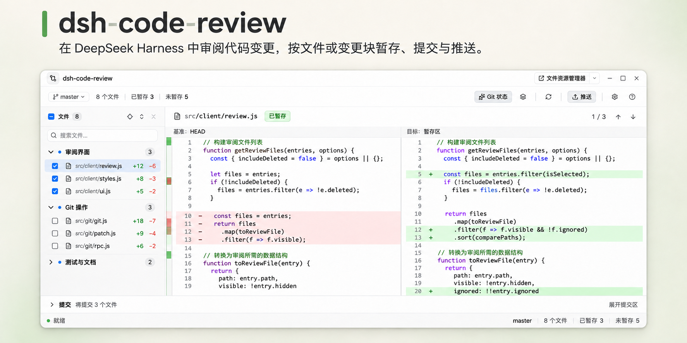
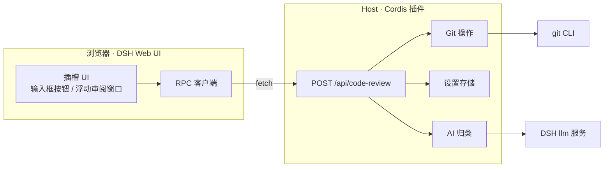

<p align="center">
  
</p>

<h1 align="center">dsh-code-review</h1>

<p align="center">在 DSH Web UI 中通过非模态浮动窗口审阅、暂存并提交当前对话所属 Git 仓库的未提交改动。</p>

<p align="center">
  <b>中文</b> · <a href="README.en.md">English</a>
</p>

<p align="center">
  
  = 20.11" src="https://img.shields.io/badge/node-%3E%3D20.11-339933?style=flat-square">
  
  
</p>

<p align="center">
  
</p>

`dsh-code-review` 是一个 DSH（DeepSeek Harness）Web UI 插件，把当前对话所属 Git 仓库的未提交改动直接放进对话里审阅：真实仓库状态、并排 diff、按文件与按变更块的暂存和还原、提交与推送。它解决的是“在 DSH 里改完代码后，不必切回终端确认改了什么、准备提交什么”的问题。它是非模态的浮动审阅窗口（同一页面可同时打开多个），不是完整的 Git 客户端——提交历史、分支、stash、rebase 等操作仍交给 Git 本身。

## 特性

**审阅与 diff**

- **真实仓库状态**：从当前对话的 `Session.header.cwd` 解析仓库，读取分支、HEAD、上游、领先 / 落后、远程，以及已暂存、未暂存、未跟踪、冲突四类条目。
- **并排 diff**：左右两栏带行号与语法高亮，未变更区域默认折叠，逐文件显示增删行数（`+n` / `−n`）；左栏是比较基准（`HEAD`、`Index`、`Worktree`、`Untracked`、`Empty` 等，表头写明标签），右栏是目标。
- **变更导航与滚动**：变更缩略条按连续变更行绘制色块，点击或拖动可快速定位，配合上一处 / 下一处变更与紧凑的 `n / m` 计数（完整文案保留在 tooltip 与仅供屏幕阅读器的文本中）；当前变更行保持灰色选中，可直接点击任意变更行切换；点击/导航选中后滚动不会覆盖它，尚未选择时计数跟随滚动；左右两栏纵向同步滚动、横向各自独立，长行不会把另一侧拖走。

**文件与变更块操作**

- **按文件操作**：每个文件行与分组标题前有勾选框，勾选即把该文件（或整组）加入暂存区 —— 也就是本次提交的内容；取消勾选移出暂存区，工作区内容保留。也可以右键文件条目暂存 / 取消暂存，或还原未暂存的改动（还原是破坏性操作，执行前需要确认）。
- **全选当前列表**：文件导航标题行有作用于当前列表的三态勾选框——勾选把当前筛选结果中尚未暂存的条目加入暂存区，取消勾选把其中已暂存的移出，部分暂存时显示半选；无搜索时作用域是整个仓库，冲突条目从不参与。列表被 Host 截断或写入进行中时全选禁用并说明原因。工具栏不再单独提供「暂存全部 / 取消暂存全部」按钮，批量能力合并到这里。
- **在外部应用中打开**：窗口标题栏的「打开项目」复用 DSH 的 open-in-app 能力，可直接用文件资源管理器 / Finder / 已安装的 IDE / 终端打开仓库目录，右侧下拉列出本机可用的应用；右键文件条目可「打开文件」或「显示文件位置」。
- **按变更块操作**：右键 diff 中的单个变更块，可以只暂存、取消暂存或还原这一块；菜单会标注目标（`文件 · 变更块 n`）并在 diff 中高亮范围，写回前重新计算并校验指纹，文件在预览后发生变化则中止。二进制、符号链接、子模块、冲突、仅模式变化以及重命名 / 复制的文件不支持按块操作，菜单会禁用并说明原因，不会退化成整文件操作；超过预览行数上限的文件显示截断预览（标注 patch-only），按块操作仍以 Host 重新计算的结果为准。

**提交与推送**

- **提交**：窗口底部是可折叠的提交区，勾选文件后展开它、填写多行提交信息并提交；提交前校验 HEAD 与暂存区指纹，Git 钩子与签名配置照常生效。
- **推送**：先预览本地源分支、目标远程 / 分支与待推送提交，可以设置上游；源分支固定为当前分支，目标分支可编辑；预览只使用本地已有的远程跟踪信息（不 fetch），永不强制推送。仓库还没有远程时，可以从分支菜单的「设置远程仓库…」直接配置（只写本地 Git 配置，不检查网络连通性）。

**AI 归类**

- **AI 智能归类（可选，默认关闭）**：把左侧文件导航重新组织为语义分组；只改变导航的分组方式，不改变 Git 状态、比较基准或操作范围。分组只随「变更路径集合 + 变更类型」更新：勾选 / 取消勾选（暂存 / 取消暂存）不会触发重新归类，列表不会先塌缩成「其他变更」再跳回。

**界面**

- **非模态审阅窗口**：审阅面板以桌面式浮动窗口呈现，不铺遮罩、不阻塞 DSH 页面——窗口后面的对话与其它界面始终可以正常使用；打开时默认占 DSH 窗口内容区的 85%，只能在 DSH 内容区内移动（四边受限，不会被拖到 DSH 标题栏或窗口外），最大化会铺满 DSH 内容区；每个会话 / 工作区各自拥有独立窗口，不同会话 / 工作区的窗口可以同时打开；标题栏提供最小化、最大化 / 还原与关闭按钮，关闭只能手动点击关闭按钮，`Esc` 不会关闭窗口本身。
- **常驻状态栏**：仓库状态可读时，窗口底部常驻一条状态栏：左侧是「就绪」（绿点，悬停显示上次刷新时间）、执行中、错误（带关闭按钮）或操作通知，右侧固定显示仓库摘要——分支、文件数，以及存在时的已暂存 / 未暂存、未跟踪 / 冲突。原先单独的刷新错误条已并入这条状态栏；宽度不足时依次隐藏相对次要的信息，而不是让状态栏整体消失。
- **分支信息菜单**：工具栏左侧的分支 chip 可展开为菜单，列出 HEAD 短 SHA、上游分支（未设置时提示「尚未设置上游分支」）与领先 / 落后，可复制分支名或仓库路径，也可以打开「设置远程仓库…」配置远程地址（只写本地 Git 配置，不检查网络，见下）。菜单不提供分支切换——插件仍不是完整的 Git 客户端。
- **语义变更摘要**：工具栏的变更摘要用语义图标表示已暂存 ✓（圆底）、未暂存 ○、未跟踪 ◌（虚线）与冲突 ⚠，并保留颜色语义与文字标签，不依赖颜色也能分辨。
- **窗口内设置与中英双语**：归类模型、附加归类要求、条目上限、会话空闲时预归类、界面语言都在审阅窗口内配置，更改自动保存；插件不注册 DSH 设置分区。
- **键盘操作与主题**：完整快捷键（见[键盘快捷键](#键盘快捷键)），跟随 DSH 的浅色 / 深色主题。
- **一致性与刷新**：每次写操作后重新读取真实 Git 状态，不做乐观更新；所有操作前都校验指纹，避免把过期预览写回工作区。文件 / 变更块操作绑定当前展示的 diff，条目指纹变化会让旧菜单失效。写操作后重新读取同一文件的 diff 时会保留上一份内容并只在标题行显示小 spinner，不再闪「正在加载差异…」骨架；只有切换文件或仓库才清空 diff 面板。
- **超量变更保护**：状态超过 2000 行时列表明显标注截断，并禁用文件导航的全选（批量暂存 / 取消暂存）与 commit；此时应缩小改动范围或改用命令行完成全局操作。

## 环境要求与兼容性

| 项目 | 要求 |
| --- | --- |
| DSH | 0.2.2-rc.1（`@deepseek-ai/dsh`）；本插件当前在该版本上开发并验证（早期版本针对 0.2.1-rc.5 编写） |
| Node.js | ≥ 20.11（Host 半运行在 DSH 的 Node 运行时中） |
| 操作系统 | Windows、macOS、Linux；需要本机可用的 `git` 命令 |
| 运行时依赖 | 无，仅使用 Node.js 内置模块 |
| 主题 | 跟随 DSH 主题（浅色 / 深色） |

插件只支持 DSH Web UI。Host 半是 Cordis 插件（ESM，零运行时依赖）；Client 半是单个浏览器产物 `client.js`，React 由宿主的模块表提供，产物中不打包框架代码。

## 安装

通过 DSH 的插件管理器安装：`install_bundle` 的安装目标可以是本插件的包目录，也可以是 `npm pack` 生成的 `.tgz`。安装会把 bundle 写入当前 DSH profile，并插入 `id` 为 `dsh-code-review` 的插件行。包没有运行时依赖，安装过程不需要 `npm install`，也不会触发构建——`client.js` 已随包提供。

### 从本地目录安装

在 DSH 的插件管理器中使用 `install_bundle`，安装目标指向本插件的包目录（包含 `package.json` 的那一层）。安装会把 Host 半写入当前 profile；刷新 DSH 页面后，输入框工具行的按钮才会出现，因为客户端 bundle 是在页面加载时载入的。

### 从 tarball 安装

```bash
npm pack
```

会得到 `dsh-code-review-<version>.tgz`（版本号以 `package.json` 中的 `version` 为准）；把该 `.tgz` 作为 `install_bundle` 的安装目标即可。

### 从 npm 安装

> **尚未发布。** 包已具备发布脚本与打包校验，但当前没有发布到 npm registry，这条路径暂不可用。

发布之后，`install_bundle` 的安装目标可以直接写包名 `dsh-code-review`。

### 升级与卸载

- **升级**：先用插件管理器的 `remove_bundle` 移除 `dsh-code-review`（管理器会以 `already-installed` 拒绝覆盖安装），再用新目录或新 tarball 安装，**然后刷新 DSH 页面**。客户端 bundle 在页面加载时载入，不刷新页面会继续运行旧版本；如果新版本包含 Host 半（`src/host/`）的改动且界面提示「Host 端不认识这个操作」，重启 DSH 后即可生效。
- **停用与卸载**：在插件管理器中禁用或移除 `dsh-code-review`；如果手动改过 profile 的 `cordis.patch.yml`，删除对应的插件行。操作后同样刷新页面。

## 使用

### 打开审阅窗口

点击对话输入框工具行中、权限 / 模式控件之后的「打开 Code Review」按钮，审阅面板以非模态的桌面式浮动窗口打开：没有遮罩、不阻塞 DSH 页面，后面的对话与其它界面始终可以正常使用；窗口默认尺寸是 DSH 窗口内容区的 85%，并且只能在 DSH 内容区内移动（四边受限，不会被拖到 DSH 标题栏下方或窗口外），最大化会铺满整个内容区。窗口只能通过标题栏的关闭按钮关闭（`Esc` 不关闭审阅窗口本身）；可以拖动标题栏移动窗口、从右侧 / 底部 / 右下角缩放、最小化到标题栏（再点标题栏的还原按钮恢复）、点击标题栏的最大化按钮或双击标题栏最大化 / 还原。再次点击入口按钮会把该会话 / 工作区已有的窗口提到最前，不会重复打开。每个会话 / 工作区各自打开独立窗口，切换工作区不会关闭或改变已经打开的窗口；窗口状态（位置、大小、最小化 / 最大化）只保存在当前页面的内存中，刷新页面会关闭所有窗口。仓库由当前对话的 `Session.header.cwd` 解析；目录不是 Git 仓库时，窗口显示空状态并提示先 `git init`。空白会话和已有对话使用同一个入口位置。

### 审阅 diff

文件列表将文件名与目录分行显示；diff 两列上方分别标明比较基准与目标。窗口外观跟随 DSH 的浅色 / 深色主题。

文件导航默认按 Git 状态分组（已暂存 / 未暂存 / 未跟踪 / 冲突），打开「AI 归类」后可按语义分组，两种视图随时切换；文件导航标题行左侧是标题与文件数，右侧同组放置快速定位 / 全部展开 / 全部收起。diff 左右并排：左栏是比较基准，右栏是目标，表头写明两侧的基准标签。未变更的大段内容默认折叠，可展开；二进制、符号链接、子模块、仅模式变化或字节超限的文件会明确提示，而不是给出错误的逐行差异；超过预览行数上限的文件显示截断预览并标注 patch-only。状态列表本身超过 2000 行时，窗口会显示截断告警并禁用全局写操作。顶部刷新按钮重新读取仓库状态，每次写操作后也会自动刷新；写操作后同一文件的 diff 会保留上一份内容、只在标题行显示小 spinner，只有切换文件或仓库才会先清空再加载。底部状态栏常驻显示就绪 / 执行中 / 错误 / 操作通知与仓库摘要，就绪时悬停绿点可看上次刷新时间；工具栏左侧的分支 chip 可展开查看 HEAD 短 SHA、上游与领先 / 落后，可复制分支名 / 仓库路径，也可打开「设置远程仓库…」配置远程地址（只写本地 Git 配置，不切换分支）；diff 头部的变更计数以紧凑的「当前 / 总数」显示，悬停可看完整文案。

### 暂存与还原

在文件行或分组标题前勾选即把该文件 / 整组加入暂存区（也就是提交内容），取消勾选移出暂存区、工作区内容保留；分组勾选框在部分暂存时显示半选。标题行的勾选框是全选：作用于当前筛选结果（无搜索时即整个仓库），勾选把其中尚未暂存的条目加入暂存区、取消勾选把其中已暂存的移出；冲突条目不参与全选，列表被截断或写入进行中时全选禁用并说明原因。工具栏不再单独提供 +/− 按钮，批量暂存 / 取消暂存的能力合并到全选。也可以右键文件条目（或聚焦后按 `Shift+F10` / 菜单键）暂存 / 取消暂存，或还原未暂存的改动（还原不可撤销，需要确认）。把焦点放在 diff 的某个变更块上可以只对这个变更块执行同样的操作；菜单会标注目标（`文件 · 变更块 n`）并在 diff 中高亮该块范围，点击未变更区域不会误触发。所有写回前都会重新计算并校验指纹，文件在预览后发生变化时操作会中止并刷新；diff 与 hunk 菜单绑定当前展示的版本，轮询发现内容变化后会重新加载。暂存 / 取消暂存后选中的文件按路径保留，不会跳到别的行。

### 提交与推送

窗口底部是可折叠的提交区（默认收起）：标题行显示「将提交 N 个文件」，展开后是多行提交信息文本框和提交按钮（文本框内按 `Ctrl/Cmd+Enter` 可直接提交）；提交主按钮固定显示「提交」，待提交文件数只出现在标题行，不在按钮上重复。勾选的文件已经暂存，提交区不再重复列出暂存预览。暂存区为空、存在未解决冲突或暂存内容在检查后发生变化时都会阻止提交（提交指纹覆盖完整暂存区，不受列表截断影响），成功后显示短 SHA 与标题。推送对话框以只读方式显示本地源分支，可编辑目标远程与目标分支；切换 remote / 目标分支会重新预览，没有上游时可以设置并推送；远程拒绝时会提示先拉取合并，插件不会自动强制推送。仓库还没有配置远程时，点工具栏左侧分支 chip →「设置远程仓库…」，填写名称（默认 origin）与仓库地址（HTTPS / SSH / 本地路径均可）；对话框会列出已有远程、点击即可填入，同名保存会更新地址。保存只写入本地 Git 配置、不测试网络连通性，成功后刷新仓库状态，推送按钮随之可用。提交信息输入框的 placeholder 给出 Conventional Commits 示例（如 `feat: 完善审阅流程`），只是输入提示、不强制格式；提交区仍默认收起，展开后是多行提交信息。

### 键盘快捷键

| 按键 | 作用 |
| --- | --- |
| `↓` / `↑` | 文件列表聚焦时切换文件；diff 行聚焦时逐行移动 |
| `Home` / `End`（文件列表聚焦时） | 跳到第一个 / 最后一个文件 |
| `Alt` + `↓` / `↑` | 在窗口任意位置切换文件（diff 行聚焦时为上一个 / 下一个变更块） |
| `Tab`（diff 区域内） | 焦点进入 diff 的变更行 |
| `Enter`（diff 行聚焦时） | 打开该变更块的右键菜单 |
| `Shift` + `F10` 或菜单键 | 在聚焦的文件条目或 diff 变更行上打开右键菜单 |
| `Ctrl`（macOS 为 `Cmd`）+ `←` / `→` | 上一处 / 下一处变更 |
| `Ctrl` / `Cmd` + `Enter`（提交信息框内） | 执行提交 |
| `R` | 刷新仓库状态 |
| `?` | 打开 / 关闭快捷键说明 |
| `Esc` | 只关闭当前聚焦窗口内最上层界面（右键菜单 → 确认框 → 推送对话框 → 设置 → 快捷键说明），不关闭审阅窗口本身；窗口只能用标题栏的关闭按钮关闭；写入进行中不关闭 |

## AI 智能归类

AI 归类是可选能力，**默认关闭**，开关是审阅窗口工具栏里的分组按钮（未开启时显示「AI 归类」，开启后显示「Git 状态」）；关闭或归类失败时继续按 Git 状态分组。工具栏的「重新归类」使用 layers（图层）图标，与「刷新」的循环箭头图标区分。

**做什么**：把左侧文件导航按项目语义重新分组（例如按模块、按业务域），让一次较大的改动更容易读。它只改变导航的分组方式。

**不做什么**：不改变 Git 状态、比较基准和操作范围；不会暂存、还原、提交或推送；也不改写代码或 diff 内容。

**什么时候重新归类**：分组签名只由「变更路径集合 + 变更类型」决定——勾选 / 取消勾选（暂存 / 取消暂存）不会触发重新请求，分组不会先塌缩成「其他变更」再跳回；只有文件集合或变更类型变化、切换仓库或点「重新归类」才重新请求。归类结果按路径映射回条目，同一文件在已暂存 / 未暂存之间切换后仍留在原分组。

**使用哪个模型**：默认使用当前用户会话正在使用的模型——Host 读取 DSH 的 `modelSelection` 会话投影（`pending` → `lastUsed` → 会话记录的请求头 → DSH 默认模型）。在设置里显式选择的模型会被持久化记住，未显式选择时跟随会话模型；切换模型会自动清空之前选择的推理等级，避免把 A 模型的档位套到 B 模型上。模型调用走 DSH 的 `llm` 服务，插件本身不保存 API 密钥。

**会发送的数据**（仅在开关打开且归类实际运行时；浏览器只提交条目 key，下列元数据与摘录由 Host 从真实 Git 状态重建）：

- 项目线索：仓库目录名、最多 40 个顶层目录名、最多 12 个清单（manifest）文件名；
- 每条变更的元数据：稳定 id、Git 状态、变更类型、路径、重命名时的旧路径、增删行数；
- 有限片段：最多 20 个新增文本文件的摘录，每个最多读取 2 KiB、取前 24 行并截断到约 1200 字符，并以明确的数据边界标注为数据。

**不会发送**：整个仓库、文件完整内容、二进制内容、Git 历史，以及任何看起来包含凭据的路径的内容（`.env*`、`.npmrc`、`.netrc`、私钥文件、`*.pem`、`*.key` 等，以及路径名包含 secret / credential / token 的条目）。

**失败回退**：模型不可用、调用失败、超时（45 秒）或返回格式无效时，界面给出提示并回退到按 Git 状态分组，不影响任何 Git 操作。归类结果按「仓库 + 模型 + 条目指纹」缓存，最多缓存 4 个仓库；「重新归类」会跳过缓存重新请求。

**预归类（可选，默认关闭）**：开启设置里的「会话空闲时预归类」后，对话任务结束且仓库存在尚未归类的变更时，Host 会在 2 秒防抖后提前归类一次并写入缓存，打开窗口时直接命中缓存、无需再等模型。它只对使用过审阅窗口的会话生效，会话重新运行时立即取消未触发的任务，缓存命中则不会调用模型；但缓存未命中时这次归类会**静默消耗模型 token**，所以默认关闭。开启前请确认当前仓库与模型使用策略允许这种提前调用。

窗口工具栏的齿轮按钮打开窗口内的设置对话框（插件不注册 DSH 设置分区）：归类模型、附加归类要求（≤ 4000 字符）、最多归类条目数（1–1000，协议硬上限 400）、会话空闲时预归类、界面语言，更改自动保存。设置持久化在宿主端 `~/.dsh/code-review/settings.json`，采用原子写入。更完整的说明见 [docs/ai-grouping.md](docs/ai-grouping.md)。

## 架构

插件由 Host 与 Client 两半组成。Host 半是 Cordis 插件，注册 `POST /api/code-review` 路由（`ctx.connection.fetch.register`），负责 Git 操作、请求校验、设置持久化和可选的 AI 归类；Client 半是单个构建产物 `client.js`，由 DSH 的客户端模块加载器在页面加载时注册，并占用输入框工具行（`conversation.input.left`）与 `shell.overlay` 两个插槽。请求经 DSH 自己的 Connection 层鉴权，插件不接触会话令牌；浏览器不直接执行 Git 命令，React 由宿主模块表提供。



Host 与 Client 之间的方法、数据形状与错误码见 [docs/protocol.md](docs/protocol.md)；分层设计与模块职责见 [docs/architecture.md](docs/architecture.md)。

## 仓库结构

- `src/host/`：Host 半（Cordis 插件），负责路由、Git 操作、协议校验、设置持久化与可选的 AI 归类。
- `src/client/`：Client 半源码（普通脚本），由 `scripts/build.mjs` 按固定顺序拼接为随包发布的 `client.js`。
- `scripts/`、`test/`、`docs/`、`locale/`：构建 / 校验 / 发布脚本、Node 测试套件、维护者文档与 zh / en 插件元数据。
- 根目录的 `index.js`、`cordis.patch.yml`、`package.json`：对外入口、Cordis bundle patch 与包清单。

逐文件的源码布局、构建顺序与编码规则见 [docs/development.md](docs/development.md)。

## 开发

需要 Node.js ≥ 20.11 与本机可用的 `git`（测试会创建真实的临时仓库）。项目零依赖，没有 `npm install` 这一步。

| 命令 | 作用 |
| --- | --- |
| `npm run build` | 由 `src/client/*.js` 重新生成 `client.js`（固定顺序，输出字节确定） |
| `npm test` | 用 Node 内置测试运行器跑全部测试（真实临时 Git 仓库，经 `scripts/test.mjs` 枚举文件，兼容 Node 20） |
| `npm run validate` | 跑 8 项发布前校验：manifest、包文件、客户端源码、产物新鲜度、Host 导入、locale 元数据、icon、密钥与绝对路径扫描 |
| `npm run validate -- --with-tests` | 先跑校验，再跑完整测试套件 |
| `npm run check` | `npm run validate -- --with-tests` 的别名，提交前跑这一条即可 |
| `npm run pack:check` | 检查 `npm pack` 产物内容与 `files` 白名单 |
| `npm run release` | 有序发布流水线：校验 → 测试 → 构建 → 打包 → 发布 |

客户端源码是普通脚本（无 ESM / JSX，只能 `require` 同级模块与宿主提供的 `react`），`client.js` 由 `scripts/build.mjs` 按固定顺序拼接生成、禁止手改；完整规则见 [docs/development.md](docs/development.md) 第 4–5 节。

开发流程与各项校验的具体含义见 [docs/development.md](docs/development.md)，完整文档索引见 [docs/README.md](docs/README.md)，面向 AI 编码代理的仓库约定见 [AGENTS.md](AGENTS.md)。

## 已知限制

- 不是完整的 Git 客户端：没有提交历史、分支管理、stash、rebase、cherry-pick。
- 分支 chip 的菜单只提供分支信息、复制与「设置远程仓库…」，不能切换分支。
- 没有冲突编辑器：冲突条目会显示并阻止提交，需要在命令行解决后回来刷新。
- 没有图片 diff；二进制文件只显示提示和统计。
- 按变更块操作只支持普通文本文件：二进制、符号链接、子模块、冲突、仅模式变化和重命名 / 复制的文件会被拒绝并说明原因；超过预览行数上限的文件只显示截断预览（patch-only）。
- 推送永不使用 force；提交只包含暂存区内容。
- 推送预览的“待推送提交”只与本地已有的远程跟踪 ref 比较，不自动 fetch；远端已变化时需要先自行 fetch。
- 「设置远程仓库」只写本地 Git 配置，不测试连通性、不自动 fetch；地址或凭据问题要等推送时由 Git 报告。
- 状态列表超过 2000 行时，窗口会标注截断并禁用文件导航的全选（批量暂存 / 取消暂存）与 commit；请缩小改动范围或改用命令行。
- 浮动审阅窗口只能停留在 DSH 内容区内：不是操作系统级独立窗口，也不能打开第二个浏览器窗口；窗口状态（位置、大小、最小化 / 最大化）只保存在页面内存中，刷新页面即关闭。
- 视觉与交互在真实 DSH Web GUI 中人工验证，没有像素级自动化测试。

## 安全与隐私

插件在本地运行：Host 半随 DSH 进程执行，Git 操作调用本机 `git` CLI，插件自身不发起网络请求；只有开启 AI 归类并实际运行时，才会通过 DSH 的 `llm` 服务把上文列出的有限数据交给模型。插件不收集遥测、不保存 API 密钥，设置中没有密钥字段；看起来包含凭据的路径不会被摘录发送。还原未暂存的改动是破坏性操作，执行前会二次确认，且无法撤销。

漏洞与安全问题请按 [SECURITY.md](SECURITY.md) 中的方式报告。

## 贡献

欢迎提交 Issue 与 Pull Request。改动请保持零运行时依赖、不手工修改 `client.js`，并在提交前跑 `npm run validate -- --with-tests`。参与前请阅读 [CONTRIBUTING.md](CONTRIBUTING.md) 与 [CODE_OF_CONDUCT.md](CODE_OF_CONDUCT.md)，版本变更见 [CHANGELOG.md](CHANGELOG.md)。

## 第三方图标

界面图标改编自 [Lucide](https://lucide.dev)（ISC License，Copyright (c) Lucide Contributors）。
SVG 几何在开发阶段从 Iconify 内联进 `components.js`，插件运行时不访问网络、不加载图标字体、
不新增依赖；许可证全文见 <https://lucide.dev/license>。

## 许可证

[MIT License](LICENSE)，版权归 2026 dsh-code-review contributors 所有。
