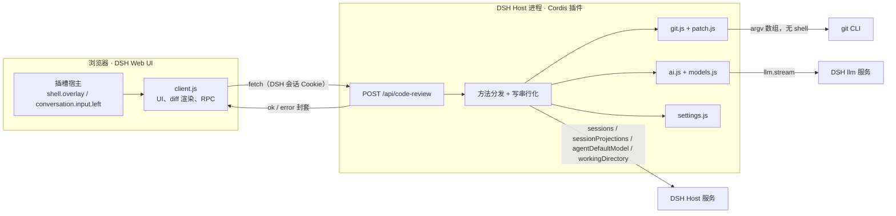
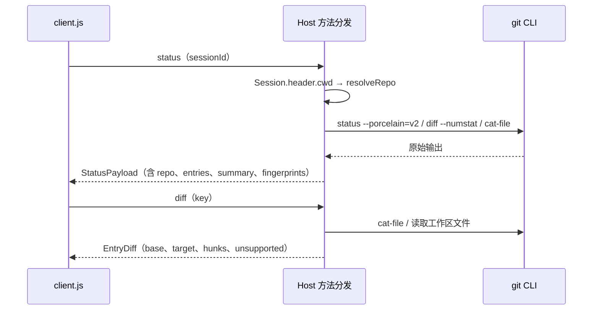
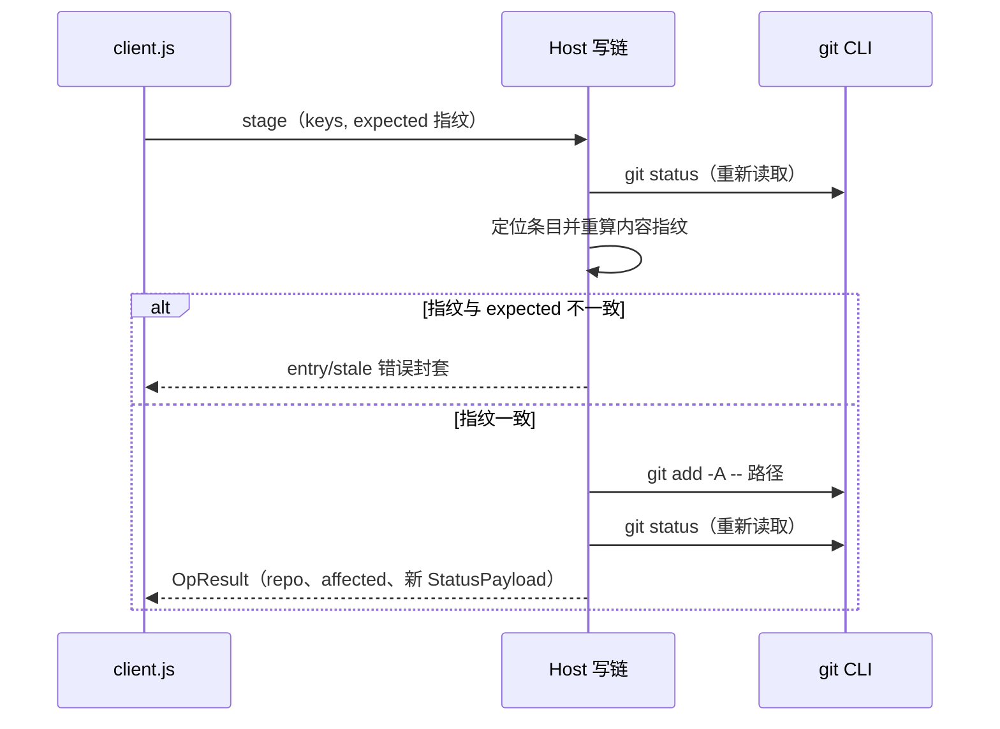

# 架构

`dsh-code-review` 是一个 DSH（DeepSeek Harness）Web UI 插件，用来审阅并提交当前对话所属 Git 仓库的未提交改动。本文说明它的分层结构、模块职责、请求如何流动、写操作为什么安全，以及构建与集成方式。方法级细节见 [protocol.md](./protocol.md)。

## 1. 概览

插件由两半组成，分别运行在不同进程：

- **Host 半**：Cordis 插件，运行在 DSH Host 的 Node 运行时中。ESM，Node.js ≥ 20.11，零运行时依赖，只使用 Node 内置模块。它注册一条 `POST /api/code-review` Fetch 路由，负责仓库解析、Git 操作、设置持久化，以及可选的 AI 归类与提交信息草拟。
- **Client 半**：一个由源码拼接生成的浏览器产物 `client.js`，由 DSH 的客户端模块加载器在页面加载时注册。React 由宿主的模块表提供，产物中不打包框架代码。它负责插槽 UI、diff 渲染、键盘交互和 RPC 调用。

整包针对 DSH 0.2.2-rc.1（`@deepseek-ai/dsh`）开发并验证（早期版本针对 0.2.1-rc.5 编写），只支持 DSH Web UI。

设计原则：

- **真实 Git 状态**：所有仓库读取都调用本机 `git` CLI；界面展示的永远是最近一次读取到的 Git 输出，不做前端推测。
- **先校验后写入**：每个写操作在真正执行前重新读取仓库、重新计算内容指纹，与客户端出示的预期不一致就中止。
- **最小协议面**：Host 与 Client 之间只有 19 个方法与一组封闭的数据形状，边界集中在一处可审计。
- **AI 只做辅助**：AI 归类只改变左侧文件列表的分组方式，不触碰 Git 状态、比较基准或操作范围；AI 生成提交信息只把草稿写进可编辑的提交信息框，不提交、不暂存、不改变任何仓库状态。
- **零依赖、确定性构建**：没有依赖安装步骤；`client.js` 的构建输出逐字节确定，产物提交进仓库并随包发布。

## 2. 进程与参与者

| 参与者 | 职责 | 关键约束 |
| --- | --- | --- |
| DSH Web 页面 | 提供插槽宿主、浏览器会话与模块加载器 | 插件只通过注册的插槽渲染，不接管页面 |
| `client.js` | 窗口 UI、diff 模型、RPC | 不直接执行 Git；只通过 DSH 的 `/api` 通道通信 |
| Host Cordis 插件 | 路由、方法分发、Git、AI、设置 | 写操作串行化；不缓存仓库状态 |
| `git` CLI | 仓库状态的唯一事实来源 | 只能通过 Host 以 argv 数组调用 |
| DSH Host 服务 | `sessions`、`connection`、`sessionProjections`、`agentDefaultModel`、`llm`、`workingDirectory` | Host 通过 `ctx.get(name)` 获取，能力缺失时降级而不是崩溃 |

## 3. Host 模块职责

| 模块 | 职责 | 要点 |
| --- | --- | --- |
| `src/host/index.js` | Cordis 入口与组合根；方法表、方法分发、路由、仓库解析、写串行化、Git 操作接线、空闲预归类调度 | `apply(ctx)` 通过 `ctx.inject(['connection'])` 注册路由，并监听 `api-session/status` 在会话空闲时按需预热归类缓存；所有写方法经同一条 Promise 链串行化 |
| `src/host/protocol.js` | 协议原语：错误类型、`{ ok, value }` / `{ ok, error }` 封套、JSON 响应，以及把不可信请求参数规范化为安全值 | 参数读取只接受协议允许的类型与范围，越界即抛协议错误 |
| `src/host/models.js` | 模型目录与归类路由解析：列出 DSH 可用模型、计算 `effectiveModel` / `sessionModel` / `selectedModel` 标签 | 只缓存 provider/model 发现结果（60 秒），会话模型每次请求重新解析 |
| `src/host/ai.js` | AI 能力：归类（两种系统提示词、用户附加要求、输入负载裁剪、回复解析与校验）与提交信息草拟（提示词、暂存 patch / 历史格式负载、纯文本回复整理）；两者共用 `llm.stream` 调用与错误映射 | 归类时模型只能返回输入中出现过的 id，未知 id 丢弃、未归类条目进入「其他变更」，逻辑模式的保留分类名 `NON_FUNCTIONAL` 被标记为 `kind: "non-functional"`；草拟只返回纯文本，不写 Git 状态 |
| `src/host/git.js` | Git 调用引擎：仓库解析、状态、单文件 diff、文件/变更块级写操作、提交、推送预览与推送、远程配置、提交信息输入（最近提交 + 暂存 patch） | 只经 Executor 以 argv 数组调用 `git`；写前用指纹校验；每个读写结果都来自新的 Git 调用；`setRemote` 只写本地配置、不访问网络；提交信息输入只读且只取已暂存内容 |
| `src/host/patch.js` | 统一 diff 的解析与单 hunk patch 构造/匹配；未跟踪文件的合成补丁 | 解析与重建按原始字节进行，CRLF、缺失行尾等边界不丢失 |
| `src/host/settings.js` | 插件私有设置的持久化：读取、合并、规范化，写入采用临时文件 + rename 原子替换 | 位于 `~/.dsh/code-review/settings.json`（可用 `DSH_HOME` 覆盖 DSH 主目录） |

包根 `index.js` 只做转出：`export { apply } from './src/host/index.js'`。`cordis.patch.yml` 向 profile 的 Loader 组合插入一行插件行（`id: dsh-code-review`，`name: @acanzaima/dsh-code-review`）；`package.json` 的 `dsh` 块声明 bundle patch 与客户端注入信息。

## 4. Client 模块职责

| 模块 | 职责 | 要点 |
| --- | --- | --- |
| `src/client/styles.js` | 完整样式表（一个字符串常量） | 只使用 DSH 主题 CSS 自定义属性；无字面颜色 |
| `src/client/ui.js` | 基础组件（design kit）：按钮/图标按钮/开关/选择器/输入框/文本域/对话框/菜单键帽/搜索框/标签，以及设置页的 Section/Row/Hint 布局原语 | 只消费主题令牌与 `util`；components 与 app 通过它获得统一控件 |
| `src/client/util.js` | 通用工具：class 名、路径拆分、计数格式化、防抖、稳定序列化等 | 不依赖 DOM，可被其它模块复用 |
| `src/client/i18n.js` | 内置中英文字典与翻译函数 | 可见字符串全部经过字典；语言可在窗口设置中固定 |
| `src/client/state.js` | 进程内运行时与多窗口 / 设置两个外部 store | 窗口列表、焦点顺序、最小化 / 最大化标记与几何尺寸都在这份 store 里；根插槽的窗口层与会话插槽的输入框按钮共享同一份状态 |
| `src/client/rpc.js` | Host 协议的客户端：`POST /api/code-review`、封套解析、错误对象 | 浏览器 Cookie 由 DSH 管理，客户端不接触令牌 |
| `src/client/open-in-app.js` | 复用 DSH 的 open-in-app：目录应用目录与启动请求，以及 `remote.session` 的打开 / 显示位置调用 | 不自己起进程；`remote.session` 通过可选 `ctx.get` 获取，不可用时只隐藏文件级动作 |
| `src/client/diff.js` | 纯 diff 模型：并排行构建、折叠区、语法高亮、变更锚点与导航 | 无 React、无 DOM，可在 Node 中直接测试 |
| `src/client/diff-view.js` | `DiffPane` 渲染器：虚拟化滚动、行号、横向独立滚动、minimap、紧凑变更计数（完整文案在 tooltip 与屏幕阅读器文本中）、变更块菜单 | 消费 `diff.js` 的模型，不重新计算 diff |
| `src/client/components.js` | 组合组件：TopBar（分支信息菜单 + 变更摘要）、StatusBar（常驻底栏）、FileNav（含提交勾选框与标题行三态全选）、菜单/对话框、提交抽屉（含 AI 草稿按钮）、推送对话框、窗口内设置（基础元素来自 `ui.js`） | 对话框接受 `scoped` 模式：`scoped` 时只覆盖所在窗口并只在窗口内捕获焦点，未指定时沿用整页对话框行为；不做请求；状态与回调由 `app.js` 传入 |
| `src/client/app.js` | 窗口层与窗口状态机、窗口外壳（拖动 / 缩放 / 最小化 / 最大化）、视口几何钳制、按窗口作用域的键盘交互与窗口内对话框、请求编排、插槽注册与 `apply(ctx)` | 暴露 `apply` 与 `inject: ['slots']`；是唯一注册插槽的模块；键盘监听挂在窗口根 DOM 节点而不是 `document` |

客户端源码的拼接顺序固定为 `util → i18n → state → rpc → open-in-app → diff → diff-view → styles → ui → components → app`，`app` 必须是最后一个。规则与理由见 [protocol.md](./protocol.md) 第 2 节与 [development.md](./development.md) 第 5 节。

### 4.1 工具栏、文件导航与常驻状态栏

- **`TopBar`**：左端的分支 chip 是按钮（`gr-branch-trigger`），点击展开菜单；菜单行由 `branchMenuItems(repo, t)` 从 `RepoRef` 的 `headSha` / `upstream` / `ahead` / `behind` / `branch` / `detached` 生成，复制动作通过 `app.js` 传入的 `onCopy` 写入剪贴板，成功后以 notice 回到状态栏；「设置远程仓库…」通过 `onSetRemote` 打开 `RemoteDialog`，保存时调用 `remoteSet`（本地 Git 配置写入，协议见 [protocol.md](./protocol.md)）。它**不提供分支切换**。中段是 `StatusPayload.summary` 派生的变更摘要（图标由 `statusGlyph` 渲染，保留颜色语义与文字标签）。右端的第一个控件是**分组方式选择器**（`ui.Select`，三选一：Git 状态 / AI 归类 · 按职能 / AI 归类 · 按功能逻辑；价值 `git` / `role` / `logic`，菜单项带说明 tooltip 与当前项勾选，触发文案为当前模式），由 `onChangeGrouping` 写入 `{ aiClassify, aiGrouping }` 设置；选择器选中两个 AI 模式之一时右侧出现「重新归类」（`IconLayers` 图层图标，与刷新的 `IconRefresh` 区分）。选择器使用 `Select` 的 `anchorMenu` 模式把 listbox 绝对定位在触发根节点内，而不是 viewport-fixed：`.gr-topbar` 是 `container-type: inline-size` 的尺寸容器，fixed 后代会被它包含 / 裁剪。分支 popover 与工具栏 `header` 是兄弟节点而不是子节点，原因相同。
- **`FileNav` 标题行三态全选**：作用域来自 `app.js` 传入的 `groups`（搜索过滤 / AI 分组之后的 `visibleGroups`；无搜索时覆盖全部条目），统计时排除 `conflict`；`allStaged` / `someStaged` 决定勾选与半选，无条目、`busy` 或 `selectAllDisabledReason`（Host 截断时为 `reason.truncated`）时禁用。点击调用 `onToggleAllStaged(entries, next)`，在 `app.js` 里复用 `toggleGroupStaged`：勾选只 `stage` 未暂存项、取消勾选只 `unstage` 已暂存项，仍走同一套指纹校验；**没有新增协议**。工具栏的批量暂存按钮已删除，批量能力只保留在这一处。标题行与文件行对齐：leading 固定 14px，trailing 用 `FileNav` 实测的滚动条 gutter（`--gr-files-scrollbar`，来自列表 `offsetWidth - clientWidth`）减去批量图标内缩，使最右侧图标的可见边缘落在文件行背景的右边缘上；列表保持 `scrollbar-gutter: stable`。
- **`StatusBar`**：仓库状态可读（`status.state === 'ok'`）时始终渲染，忙碌 / 错误 / 通知期间同样显示。左侧依次是忙碌（`busy` + `operation`）、可关闭错误（`error`）、操作通知（`notice`）与「就绪」；就绪点的 tooltip 用 `StatusPayload.generatedAt` 格式化为本地时间。右侧摘要来自 `StatusPayload.repo` 与 `StatusPayload.summary`；宽度不足时由 `@container gr-statusbar` 先隐藏未跟踪 / 冲突，再收起整个摘要。原先单独的刷新错误条已并入这里（`refreshError` / `operationError` 作为 `error` 传入）。
- 以上状态栏 / 摘要 / 文件导航数据仍来自既有的 `StatusPayload` / `RepoRef`（分支菜单里的「设置远程仓库…」是单独的 `remoteSet` 写方法，见 [protocol.md](./protocol.md) 第 4 节）；数据形状见 [protocol.md](./protocol.md) 第 5 节。

## 5. 数据流

### 5.1 状态与 diff 读取

`status` 返回后，客户端按返回的 `entries` 重建列表；选中文件才请求 `diff`。`diff` 的基准随条目的 Git 状态而定：已暂存是 `HEAD → 暂存区`，未暂存是 `暂存区 → 工作区`，未跟踪是 `空 → 工作区`。每个回复都带 `repo`，客户端据此丢弃属于其他仓库的迟到响应；diff 加载以「选中条目 + 该条目的 `fingerprint`」为依赖，快照指纹变化会重新拉取并让旧 hunk 菜单失效。hunk 操作对象取自当前展示的 `EntryDiff.entry`，与屏幕内容同一版本。

**diff 保留策略**：写操作（stage / unstage）会改写当前条目的 key 与指纹，从而合法地重新拉取 diff；客户端在 `setDiffState` 里比较新旧 `EntryDiff.entry.path`，同一文件时保留上一份 `value`、只置 `loading`，由 `DiffPane` 在「有旧内容 + loading」时继续渲染旧 diff 并在标题行显示小 spinner；只有文件路径变化（换文件或换仓库）才清空面板并显示完整骨架。这样一次勾选不会被误认为整页重载。

### 5.2 写操作

所有写方法（stage / unstage / discard、三个 hunk 方法、commit、push、remoteSet、settingsSet）都进入同一条插件级写链，因此同一窗口（乃至不同窗口）的两个写操作不会交错。写链只约束本插件；外部工具随时可能改动仓库，所以真正的正确性来自写前的重新读取与指纹校验，而不是队列本身。

`remoteSet` 是本地配置写操作：参数经 `protocol.js` 校验名称 / 地址（地址只做浅语法校验），再调用 `git remote set-url`（同名已存在）或 `git remote add`（不存在）写本地 Git 配置，随后重新读取 `StatusPayload` 返回；它不发起网络请求、不校验可达性，也不会自动 fetch，因此远程凭据 / 地址问题要等 push 时由 Git 报错。

### 5.3 AI 归类

1. 客户端在 AI 模式下、分组签名变化、AI 模式变化、切换仓库或用户点「重新归类」时调用 `classify`，携带条目 key、本次 `grouping`（`role` / `logic`）与请求 id；条目元数据与摘录候选由 Host 从新读取的状态重建。分组签名是 `aiEntriesSignature`：由「变更路径 + 变更类型（+ 重命名旧路径）」排序后求哈希，**不包含 entry key / 状态 / 指纹**，因此勾选 / 取消勾选（暂存 / 取消暂存）不会改变签名、不会重新归类。
2. Host 重新读取状态，按设置截断条目，生成项目线索与有限摘录，解析本次应使用的模型路由与有效模式（显式 `grouping` 优先，否则使用持久化的 `aiGrouping`）。
3. Host 按模式选择系统提示词（按职能 / 按功能逻辑），通过 DSH `llm.stream` 发起一次低温度请求，带 45 秒超时与可取消的 AbortSignal；结果里的 `grouping` 回报本次模式。
4. 回复被解析为分类结构，并对照真实条目集合校验：未知 id 丢弃，未归类条目进入「其他变更」；逻辑模式下名为 `NON_FUNCTIONAL` 的分类被标记为 `kind: "non-functional"`，客户端把它本地化为「非功能变更」并保留模型给的一句话说明作为 tooltip。
5. 客户端把回复里的 entry key 经发送时记录的 key→path 表转换成路径分类（`aiPathGroups`），导航再按路径把当前条目映射进组（`aiGroups`）；同一文件在 staged / unstaged 之间切换后 key 变了、path 不变，因此仍留在原组，不会掉进「其他变更」。切换 AI 模式会取消进行中的请求并丢弃旧模式的回复，然后按新模式重新请求。失败时回退为按 Git 状态分组。结果按「仓库 + 模型 + 分组模式 + 条目指纹」缓存于 Host 内存。

### 5.4 AI 生成提交信息

1. 用户在展开的提交区点击 sparkles 图标按钮。按钮只在「有已暂存条目、无未解决冲突、列表未被截断」时可用（与提交按钮的阻止原因一致，但不要求提交信息非空）。
2. 客户端只发送 `{ requestId, sessionId? }` 调用 `commitMessage`；Host 重新读取状态、取已暂存条目，并在同一次请求里只读地取两份输入：`git diff --cached`（有界 patch）与 `git log`（最近 20 条提交的 subject / 正文摘录）。
3. Host 用与 AI 归类相同的有效模型路由与推理档位调用一次 `llm.stream`（温度 0、45 秒超时、可取消）。提示词优先沿用仓库历史提交格式；没有历史或看不出稳定格式时使用 Conventional Commits `type(scope): 摘要`，多个独立细节用 `- ` 列表写在标题下。
4. 回复按纯文本整理（去代码块围栏、去“提交信息：”之类前缀、规范空行、≤ 4000 字符），返回 `{ message, model, history, repo }`；客户端把 `message` 写进可编辑的提交信息框，由用户确认后手动提交。
5. 任何失败都只返回错误封套，不写 Git 状态、不改动已暂存内容；折叠提交区、关闭窗口或再次生成会取消请求（`commitMessageCancel`）。该动作与 AI 归类互相独立，不依赖 `aiClassify` 开关。

## 6. 写安全不变量

| 不变量 | 实现 |
| --- | --- |
| 内容指纹 | 对象侧使用 git object id（内容寻址），工作区侧使用流式 SHA-256；缺失一侧记为 `empty`，子模块目录记为 `dir`；`mode` 与 submodule `gitlink` 也参与比较 |
| 写前重读 | 写方法先重新读取状态、重新计算目标条目的指纹；不一致时返回 `entry/stale` 且不写 |
| 单一写链 | 插件内所有写方法共用一条 Promise 链，避免插件自身的并发写交错 |
| 还原需确认 | `discard` / `discardHunk` 是破坏性操作，客户端必须经过确认对话框 |
| 目标集合完整 | `stage` / `unstage` 的 `"all"` 以完整仓库为目标，`expected` 必须精确覆盖目标集合；展示截断不影响写范围校验 |
| hunk 绑定 | 客户端只对当前展示的 `EntryDiff.entry` 发 hunk 操作；Host 写前重新读取状态并校验该 entry 指纹，`hunkIndex` 必须落在当前 diff 中 |
| 补丁精确 | 单 hunk patch 由原始 diff 行重新生成，经 `git apply --cached` / `-R` 应用；不存在模糊匹配 |
| 提交预期 | 提交携带 `{ headSha, stagedFingerprint }`，`stagedFingerprint` 覆盖完整 index（`git ls-files -s`），Host 重新推导后不一致即返回 `commit/stale`；提交信息经 stdin 传入，钩子与签名照常生效 |
| 只提交暂存区 | 存在冲突或暂存区为空时拒绝提交；不会自动暂存 |
| 推送不强制 | 源分支固定为当前本地分支，显式 refspec 为 `refs/heads/<source>:refs/heads/<target>`，`setUpstream` 时加 `-u`，永不传 `--force`；预览比较 `refs/remotes/<remote>/<target>` |
| 明文日志 | 未预期异常的原始 message/堆栈只写 Host 日志；线上只返回稳定的 `internal` 与安全 details。客户端按 `error.code` 显示本地化文案 |
| 不做乐观更新 | 写操作成功后返回重新读取的 `StatusPayload`，客户端用它替换本地快照 |
| 路径安全 | 路径作为 argv 值传入，Executor 的 `literal` 选项为所有按路径调用注入 `GIT_LITERAL_PATHSPECS=1`，文件名不会被当作选项、glob 或 pathspec 魔法 |
| 资源上限 | 每次 git 调用 120 秒超时、64 MiB 输出上限；状态轮询只读对象大小/身份，大对象不加载正文 |

## 7. 构建管线

`client.js` 由 `scripts/build.mjs` 生成，流程是"读取固定顺序的源码 → 逐文件静态检查 → 拼接进固定的模块加载封套 → 行尾归一化 → 写出"。输出是确定性的：同一份源码重复构建字节一致，因此新鲜度可以逐字节比较。

选择普通脚本拼接而不是现代 bundler，原因如下：

- DSH 的客户端模块加载器要求产物通过 `window.__ModuleLoader__.load({ id, factory })` 注册；本插件只需要在 `factory` 内提供 `__def` / `__req` 两个小函数即可满足这个契约。
- 包没有任何构建依赖，源码就是可读的普通脚本；不需要打包器、转译器或 JSX 运行时，构建脚本本身也只用 Node 内置模块。
- 拼接顺序显式写在 `ORDER` 数组里，配合静态检查（ESM / JSX / `document.body` / 字面颜色 / 非法 `require`）把错误挡在构建阶段，而不是等到浏览器里出现运行时异常。
- 产物进仓库、随包发布，使用者安装时不需要构建；校验脚本负责保证产物与源码同步。

## 8. 插槽与注册

| 插槽 | entry id | order | 内容 | 挂载方式 |
| --- | --- | --- | --- | --- |
| `shell.overlay` | `dsh-code-review-styles` | 0 | 常驻 `<style>` 节点，注入整个样式表 | 页面加载后常驻 |
| `shell.overlay` | `dsh-code-review-panel` | 120 | 全帧窗口层，渲染零 / 一 / 多个浮动审阅窗口；没有模态遮罩 | 常驻注册，随窗口 store 显隐 |
| `conversation.input.left` | `dsh-code-review-composer` | 10 | 输入框工具行的打开按钮，接收 `sessionId` prop | 会话作用域，位于权限 / 模式控件之后、模型选择器之前 |

插件**不注册** `settings.section`：所有配置都在审阅窗口内的设置对话框中完成。两个 `shell.overlay` 条目分开注册，是因为样式表必须在没有任何窗口、只剩输入框按钮时仍然生效。

## 9. 安全边界

- **谁能调用路由**：`POST /api/code-review` 注册在 DSH 自己的 Connection 层上，浏览器会话由 DSH 认证，插件不读取、不保存任何令牌；只有 DSH 认证并转发的请求会到达插件。
- **不保存密钥**：插件没有 API key 字段，模型调用通过 DSH 的 `llm` 服务完成；设置文件只存行为配置（语言、模型选择、条目上限、附加归类要求）。
- **本地执行**：Git 操作调用本机 `git` CLI；插件本身不发起网络请求，唯一的模型网络访问由 DSH 的 `llm` 服务代理。
- **进程调用安全**：没有 shell、没有字符串插值、没有 `process.chdir`；路径作为独立 argv 传入并启用字面量 pathspec 模式。
- **数据最小化**：AI 归类只发送项目线索、条目元数据和有界摘录；凭据类路径不发送内容（清单见 `docs/ai-grouping.md`）。AI 生成提交信息只在用户显式点击时运行，发送已暂存 patch 与最近提交的格式参考（清单见 `docs/ai-commit-message.md`），不点击就不发送。
- **错误不泄露实现**：所有异常被映射为协议错误封套；已知错误的 `message` 是稳定英文诊断，未预期异常只记录到日志并返回固定的 `Internal error`；窗口文案由客户端按 `error.code` 本地化。

## 10. 设计取舍与已知限制

- **审阅窗口而非 Git 客户端**：没有提交历史、分支管理、stash、rebase、cherry-pick；这些操作仍交给 Git 本身。
- **没有冲突编辑器**：冲突条目会被显示并阻止提交，需要先在命令行解决再刷新。
- **diff 有上限**：单个 diff 侧超过 2 MiB 或 40000 行时标记为不可完整展示；状态列表最多返回 2000 行。这是为了避免在浏览器中渲染超大内容。状态被截断时客户端显示告警并禁用文件导航的全选（批量暂存 / 取消暂存）与 commit，避免操作无法完整预览的全局范围。
- **资源有上限**：每次 git 调用 120 秒超时、64 MiB 输出；超限返回稳定的 `repo/timeout` / `repo/output-too-large`，避免卡死的钩子或夸张输出拖住写链、耗尽内存。
- **推送预览不 fetch**：待推送提交只与本地已有的远程跟踪 ref（`refs/remotes/<remote>/<target>`）比较；远端已变化时需要先自行 fetch，预览不会阻塞在网络操作上。
- **按块操作范围有限**：只支持普通文本文件；二进制、符号链接、子模块、仅模式变化、冲突、重命名 / 复制和超限文件会明确说明原因并拒绝，而不是退回整文件操作；被截断的 diff 会标注只显示补丁范围。
- **没有图片 diff**：二进制文件只显示提示与行数统计。
- **窗口只在内存**：打开的窗口、位置以及最小化 / 最大化状态只保存在当前页面内存中，刷新页面即全部关闭；这里不做窗口状态持久化。
- **不是操作系统级窗口**：插件 API 只在 DSH 页面内渲染，因此窗口是页面内的浮动层，不是独立的操作系统窗口，也不能打开第二个浏览器窗口。窗口层顶部让出 `--dsh-frame-top-clearance` 对应的 DSH 标题条，几何计算把“工作区”定义为标题条下方的内容区：拖动四边受限、窗口不会被拖到标题栏下方或窗口外，最大化铺满整个内容区。
- **窗口之间状态独立、设置共享**：每个窗口的 UI 状态（当前选中文件、diff 快照、窗口内对话框）互不影响；插件设置在所有窗口间共享。
- **关窗始终手动**：切换会话 / 工作区、滚动或操作窗口后面的页面都不会自动关闭窗口，窗口只能通过标题栏的关闭按钮关闭。
- **写链只约束本插件**：外部工具可在操作之间改动仓库，所以每次写都重新校验，而不是依赖队列。
- **AI 默认关闭、两种视角同源**：默认按 Git 状态分组，不选择 AI 模式时插件不会向模型发送任何数据；「按职能」与「按功能逻辑」共用同一份有界输入和同一份缓存键（额外包含分组模式），功能逻辑分类不读取文件内容，因此仍属于导航辅助而不是代码理解；归类失败总是回退到 Git 状态分组。
- **提交信息草稿是显式动作**：不点击提交区的 AI 按钮就不会发送任何代码内容；草稿只填入可编辑的提交信息框，不自动提交。由于 patch 必然包含已暂存内容的真实文本，涉密仓库需要自行决定是否使用。
- **验证方式**：协议、Git 引擎与打包行为有自动化测试覆盖；窗口的视觉与交互在真实 DSH Web GUI 中人工验证。当前验证环境为 Windows + Git for Windows，其他平台未单独验证。
